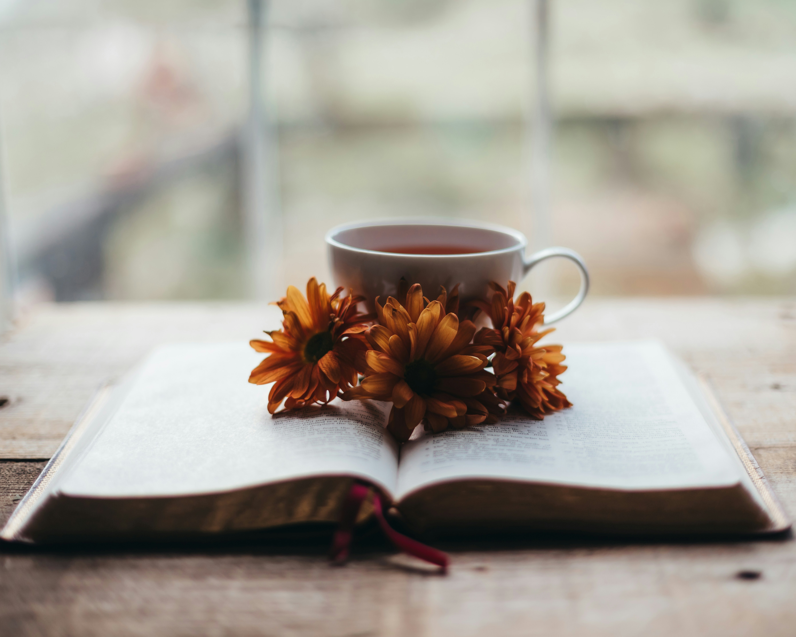

# How to Study the Bible

## Getting Started

Studying the Bible is about more than reading verses. It is an opportunity to understand God's Word, reflect on its meaning, and consider how it applies to everyday life.

## My Approach to Bible Study

### Reading With Intention

When I study the Bible, I usually begin with prayer. Instead of following a specific reading plan, I open my Bible and read whatever stands out to me. I approach this with the belief that God can lead me to the scripture I need in that moment.

What makes this experience meaningful is how often the passage relates to my current circumstances or emotional state. Sometimes it offers encouragement, while other times it challenges me to think differently about something I'm experiencing.

### Reflecting on What I Read

After reading a passage, I try to understand what it is saying and how it applies to my life. I believe reflection is important because reading scripture and understanding its meaning are not always the same thing.

Some questions I can ask myself include:

- What is happening in this passage?
- Who was it originally written for?
- What does this scripture teach me about God?
- How does it relate to what I'm experiencing?
- Is there something I need to change or put into practice?

## Connecting Scripture to Daily Life

I believe studying the Bible should influence how we live, not just what we know. A passage may provide comfort during a difficult season or encourage patience, forgiveness, and personal growth.

Prayer helps me prepare my heart before reading, but understanding the context helps me avoid interpreting scripture only through my emotions.

> Reading scripture gives me an opportunity to seek God's guidance while also examining my own thoughts and actions.

For more ways to explore scripture, see [[understanding-scripture|Understanding Scripture]] and [[bible-study-methods|Bible Study Methods]].

## A Peaceful Moment With Scripture

*Photo by Sixteen Miles Out on [Unsplash](https://unsplash.com/photos/IS-rtG07kgg).*
